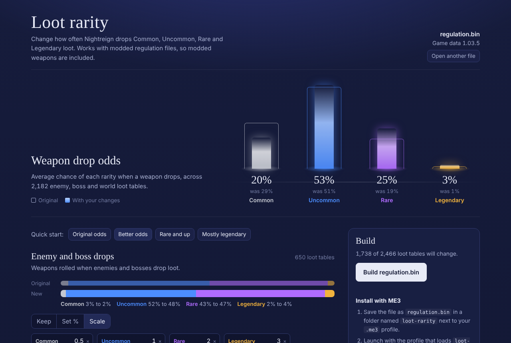

# Nightreign Loot Rarity

Change how often **Elden Ring Nightreign** drops Common, Uncommon, Rare and Legendary loot, then play it with [Mod Engine 3 (ME3)](https://github.com/garyttierney/me3).

The editor reads your `regulation.bin`, vanilla or modded. It lists every loot table that rolls a rarity, lets you set new odds, and writes a new `regulation.bin` that ME3 loads on top of the game. Each weapon's rarity comes from the game data itself, so weapons added by other mods are included automatically.

The editor is a single web page that runs in your browser. Nothing gets installed, and your files never leave your computer.

https://ezriyal.github.io/Elden-Ring-Nightreign-Loot-Table-Editor/Nightreign-Loot-Rarity-Editor.html



## What you need

- Elden Ring Nightreign on PC. Tested with game data 1.03; other versions work if the loot data format is the same, and the editor stops with an error if it isn't.
- [ME3](https://github.com/garyttierney/me3/releases), recent version
- Chrome, Edge or Firefox

## Quick start

1. Download this repository (**Code > Download ZIP**, or the latest release) and extract it anywhere outside the game's `Game` folder.
2. Open `Nightreign-Loot-Rarity-Editor.html` in your browser.
3. Click **Choose regulation.bin** and pick the file your game uses now:
   - Unmodded game: `...\steamapps\common\ELDEN RING NIGHTREIGN\Game\regulation.bin`
   - With a mod that has its own regulation.bin: the mod's copy. See [Using it with other mods](#using-it-with-other-mods).
4. Set the odds, or click one of the quick starts.
5. Click **Build regulation.bin**, then **Save regulation.bin**, and save it as `loot-rarity\regulation.bin`.
6. Double-click `Loot Rarity.me3` to start the game through ME3.

To change the odds later, repeat steps 2 to 6. In step 3, always open the original regulation.bin, never the one in `loot-rarity`, or your changes pile up. The editor warns you if it recognises a file it built.

## Changing the odds

The editor groups loot tables by where the loot comes from:

| Source | What it covers |
| --- | --- |
| Enemy and boss drops | Weapons rolled when enemies and bosses drop loot |
| Chests and world loot | Weapons from chests, item pickups and location rewards |
| Weapon pools | Rarity rolls inside a loot table after it has been picked, such as shields, staves and seals |
| Talismans | Talisman rewards that roll a rarity |
| Consumables | Item tables where consumables of different rarities compete |

Each source can be changed in one of three ways:

- **Keep**: leave the tables alone.
- **Set %**: every table in the source rolls the rarities you type, for example Common 10, Uncommon 40, Rare 35, Legendary 15. The numbers only decide *which* rarity a weapon drop is. How often a weapon drops at all, and what else a table can give, stays the same.
- **Scale**: multiply each rarity's weight, for example Common x0.5 and Rare x2. Tables keep their own balance, so early chests are still worse than late ones.

With **Set %**, the option **Add rarities a table never had** puts a missing rarity into a table. The new entry draws from the matching weapon pool when one exists, for example the Rare version of the same pool. Otherwise it uses the game's general pool for that rarity. Without the option, a rarity a table never had stays at 0 and its share goes to the rarities the table does have.

Open **Fine-tune** under a source to set odds for one table type, or open a type and click **Edit** to set odds for a single table. The most specific setting wins: single table, then table type, then source.

Your numbers are remembered by the browser. **Save settings** writes them to a file, which you can load again after an update.

## Using it with other mods

If another mod ships its own `regulation.bin`, such as a weapon mod or an overhaul:

1. In the editor, open **that mod's** regulation.bin. Everything the mod changed stays, including its weapons.
2. Add the mod to `Loot Rarity.me3` and make `loot-rarity` load after it, so the loot-rarity copy is the one the game uses:

```toml
[[packages]]
id = "othermod"
path = 'path/to/othermod'

[[packages]]
id = "loot-rarity"
path = 'loot-rarity'
load_after = [{ id = "othermod", optional = false }]
```

Mods that don't touch `regulation.bin`, such as DLL mods or model and texture mods, need nothing special. Keep them in the profile as usual.

## After a game or mod update

Open the new original `regulation.bin`, load your settings if needed, then build and save again. If the editor says a param has an unexpected size, the game changed its data format and the editor needs an update.

## Online and co-op

ME3 keeps the game off the official servers by default. Never play a modded regulation online on official servers. For co-op through Seamless Co-op or a community server, everyone should use the same `regulation.bin`.

## Uninstall

Delete `loot-rarity\regulation.bin`, or launch the game without this profile. Nothing else is changed.

## How it works

- `regulation.bin` is AES-256-CBC encrypted, then zstd-compressed (DCX), and holds a BND4 archive of all game params.
- Rarity is rolled in `ItemLotParam_enemy`, `ItemLotParam_map` and `ItemTableParam`. The editor follows every loot entry down through nested item tables to `EquipParamCustomWeapon` and then to `EquipParamWeapon.rarity` (or talisman and goods rarity). It then reweights the entries of every table whose entries lead to different rarities.
- Added rarities go into empty slots of the loot row and copy the slot settings of an existing weapon entry.
- The new file is packed with **zstd 1.5.7** compiled to WebAssembly, using the same settings as Smithbox: level 15, 64 KiB window, no content size or checksum field. The game crashes on files with zstd blocks larger than 64 KiB, which is why the packing matters.
- After building, the editor decrypts and decompresses its own output and compares it byte for byte with the intended data before you can save it.

## Building from source

The editor is assembled from the files in `src`:

```
python src/assemble.py            # writes Nightreign-Loot-Rarity-Editor.html
sh src/wasm/build_wasm.sh         # rebuilds src/nrzstd.wasm (needs clang + wasm-ld)
```

| File | Purpose |
| --- | --- |
| `src/core.js` | Reads, analyzes and patches regulation.bin |
| `src/ui.js`, `src/template.html` | The editor page |
| `src/zstd.js` | zstd decoder used to read the file |
| `src/zstdwasm.js`, `src/nrzstd.wasm` | libzstd compressor used to write the file |
| `src/wasm/`, `src/zstd-1.5.7/` | Sources for `nrzstd.wasm` |
| `src/names.json` | Loot table names shown in the editor |

## Credits and license

- Loot table names and param layouts: [Smithbox](https://github.com/vawser/Smithbox) and the Paramdex community definitions. Smithbox is GPL-3.0.
- Compression: [zstd](https://github.com/facebook/zstd) 1.5.7, BSD license. See `src/zstd-1.5.7/LICENSE`.
- Mod loading: [ME3](https://github.com/garyttierney/me3).

This project is released under the GNU General Public License v3.0 (see `LICENSE`). It is not affiliated with FromSoftware or Bandai Namco. Don't commit or share `regulation.bin` files; they contain the game's data.
